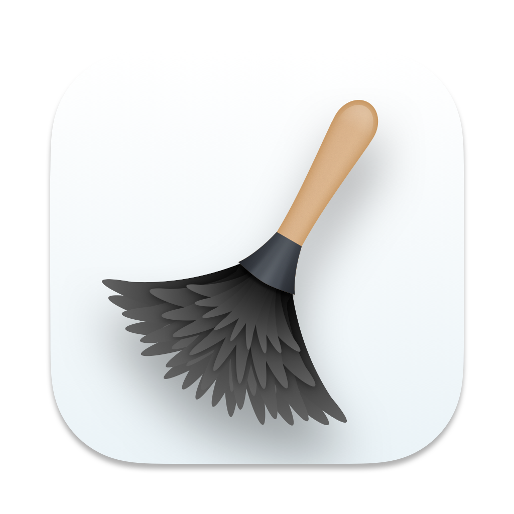
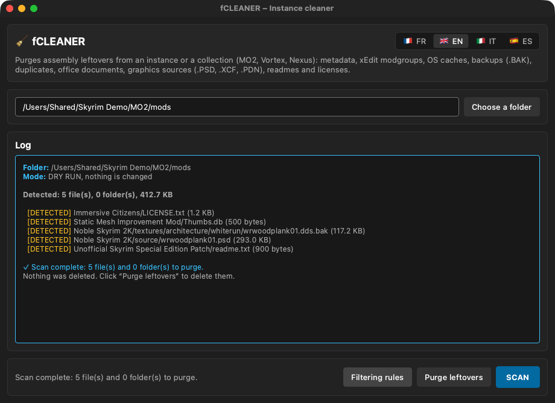

<p align="center"></p>

# fCLEANER

**Cleans the leftovers of a flattened mod setup: metadata, backups, duplicates, sources, readmes…**  
*Nettoie les résidus d'une installation de mods aplatie : métadonnées, sauvegardes, doublons, sources, lisez-moi…*

🇬🇧 [English](#-english) · 🇫🇷 [Français](#-français)

---
## 🇬🇧 English

### What it does

After flattening a mod list (with mO2FLATTENER or by hand), the game folder is full of files the game never uses. fCLEANER scans a folder, shows what would be removed (dry run) and purges it only when you ask.

### Features

- **Scan** first (dry run): nothing is deleted, the full list is shown with sizes.
- Removes OS caches (thumbs.db, desktop.ini, .DS_Store) and MO2 hidden files (`*.mohidden`).
- Removes xEdit modgroups and Vortex / Nexus collection metadata and staging leftovers.
- Removes backups and temporary files (`*.bak`, `*.tmp`, `* - copy.*`), office documents and graphic sources (.psd, .xcf, .pdn).
- Removes readmes, changelogs and licenses.
- Built-in **filtering rules** window listing everything that is targeted.
- Interface in **English, French, Italian and Spanish** (follows your Mac's language; can be changed in the app).

### What's new in 1.3.0

- Signed with a Developer ID and notarized by Apple: macOS now opens the app without a security warning.
- The app's launcher is now compiled from source when the app is built, instead of using PyInstaller's generic prebuilt launcher, which antivirus scanners tend to flag. No change in features.
- The first letter of the app's name now uses the colour of its logo everywhere it appears.
- Version number aligned across the Skyrim Mac Toolkit.

### Updates

The app checks once a day whether a newer release exists on GitHub and offers to open the Nexus page, remind you later or skip that version. Nothing is downloaded or installed automatically. The full history is in [CHANGELOG.md](CHANGELOG.md).

### Screenshots


*Dry-run scan of a mods folder*

### Requirements

A Mac with **Apple Silicon** (M1 or later), **macOS 13 Ventura** or later. No Python, no Wine, no virtual machine needed.

### Installation

1. Download the zip from Nexus Mods (or from the GitHub releases) and unzip it.
2. Move **fCLEANER.app** to your **Applications** folder.

### How to use

1. Click **Choose a folder** and select the assembled game folder (or a mods collection).
2. Click **SCAN** and read the log.
3. If the list is right, click **Purge leftovers**.

### FAQ

**Is the purge reversible?**  
No: deleted files are not moved to the Trash. Always read the scan first, and keep a backup of your modlist.

### Building from source

Requires Python 3.12 with PyQt6 and PyInstaller. From the repository folder:

```bash
./build_app.sh
```

### License

Released under the **MIT License**: free to use, modify and share. Part of the **Skyrim Mac Toolkit**, a set of modding tools built for Skyrim players on Mac.

---

## 🇫🇷 Français

### À quoi ça sert

Après l'aplatissement d'une liste de mods (avec mO2FLATTENER ou à la main), le dossier du jeu est plein de fichiers que le jeu n'utilise jamais. fCLEANER analyse un dossier, montre ce qui serait supprimé (simulation) et ne purge que sur demande.

### Fonctions

- **Analyse** d'abord (simulation) : rien n'est supprimé, la liste complète s'affiche avec les tailles.
- Supprime les caches système (thumbs.db, desktop.ini, .DS_Store) et les fichiers masqués de MO2 (`*.mohidden`).
- Supprime les modgroups xEdit et les métadonnées et restes de staging des collections Vortex / Nexus.
- Supprime les sauvegardes et fichiers temporaires (`*.bak`, `*.tmp`, `* - copie.*`), les documents bureautiques et les sources graphiques (.psd, .xcf, .pdn).
- Supprime les lisez-moi, journaux de modifications et licences.
- Fenêtre **Règles de filtrage** qui liste tout ce qui est ciblé.
- Interface en **français, anglais, italien et espagnol** (suit la langue du Mac ; modifiable dans l'appli).

### Nouveautés de la 1.3.0

- Signée avec un certificat Developer ID et notarisée par Apple : macOS ouvre désormais l'appli sans avertissement de sécurité.
- Le lanceur de l'appli est maintenant compilé depuis les sources à la construction de l'appli, au lieu du lanceur générique précompilé de PyInstaller, souvent signalé par les antivirus. Aucun changement de fonctionnalités.
- La première lettre du nom de l'appli prend la couleur de son logo partout où il est écrit.
- Numéro de version commun à tout le Skyrim Mac Toolkit.

### Mises à jour

L'appli vérifie une fois par jour si une version plus récente existe sur GitHub et propose d'ouvrir la page Nexus, de rappeler plus tard ou d'ignorer cette version. Rien n'est téléchargé ni installé automatiquement. L'historique complet est dans [CHANGELOG.md](CHANGELOG.md).

### Captures d'écran


*Analyse simulée d'un dossier de mods*

### Configuration requise

Un Mac **Apple Silicon** (M1 ou plus récent), **macOS 13 Ventura** ou plus récent. Ni Python, ni Wine, ni machine virtuelle.

### Installation

1. Téléchargez le zip sur Nexus Mods (ou dans les releases GitHub) et décompressez-le.
2. Placez **fCLEANER.app** dans votre dossier **Applications**.

### Utilisation

1. Cliquez sur **Choisir un dossier** et sélectionnez le dossier de jeu assemblé (ou une collection de mods).
2. Cliquez sur **ANALYSER** et lisez le journal.
3. Si la liste convient, cliquez sur **Purger les résidus**.

### Questions fréquentes

**La purge est-elle réversible ?**  
Non : les fichiers supprimés ne vont pas dans la Corbeille. Lisez toujours l'analyse d'abord et gardez une sauvegarde de votre modlist.

### Compiler depuis les sources

Nécessite Python 3.12 avec PyQt6 et PyInstaller. Depuis le dossier du dépôt :

```bash
./build_app.sh
```

### Licence

Publié sous **licence MIT** : libre d'utilisation, de modification et de partage. Fait partie du **Skyrim Mac Toolkit**, un ensemble d'outils de modding pensés pour les joueurs de Skyrim sur Mac.
